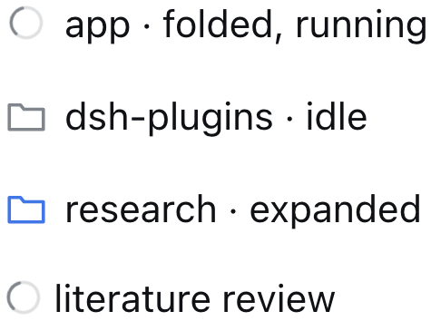

# dsh-workspace-running-indicator

**DeepSeek Harness 侧边栏里，被折叠的工作区会显示它藏起来的会话在做什么：有会话正在工作就是「进行中」的加载动画，一轮跑完但没人看过就是绿色的完成圆点** —— 把侧边栏本来就会画在会话行上的标记，还原到折叠把它藏起来的位置。

[English](README.md) | **简体中文**

[](LICENSE)
[](https://github.com/icrefin/dsh-workspace-running-indicator/releases/tag/v0.2.1)
[](https://github.com/icrefin/dsh-workspace-running-indicator/actions/workflows/ci.yml)
[](https://github.com/icrefin/dsh-workspace-running-indicator/commits/main)
[](https://github.com/icrefin/dsh-workspace-running-indicator/stargazers)
[](https://github.com/icrefin/dsh-workspace-running-indicator/pulls)
[](https://nodejs.org)
[](https://github.com/deepseek-ai/deepseek-harness)

## 问题

一旦折叠，工作区里的会话行就全部隐藏了。于是不论里面有三轮对话正在跑、有一轮刚跑完却没人看、还是一周都没有动静，标题行画的都是同一个文件夹图标 —— 而行自己的加载动画和绿色圆点其实还在组内渲染，只是已经没有行可以承载它们。

```
Workspaces
  ◌ app · folded, running          ← 本插件：标题行本身就是状态
  ● dsh-plugins · finished unviewed
  ▢ ic_decryptor · idle
  ▾ research · expanded
      ● literature review          ← 原版：会话行自己的完成圆点
      ◌ chip bring-up              ← 原版：它的进行中加载动画
```



## 工作原理

工作区标题行属于原版 UI，而且**没有任何槽位（seat）**：

| 归属 | 职责 |
|---|---|
| `dsh-client-ui-workspace` | 把每个工作区标题渲染成 `role="treeitem"`，键是 `data-row-key="workspace:<id>"`，折叠状态写在 `aria-expanded` 上 |
| `sidebar.session.row.leading` | 每*会话*行的单元格 —— 工作区标题行没有这个位置 |
| `sidebar.workspaces` | 一个已被占用的槽位，承载整个浏览器面板：分组、嵌套、排序、搜索、拖拽与菜单 |

为了一个图标去顶替那个槽位，等于把整个浏览器面板的职责接过来。本插件改成从页面侧只装饰它真正需要的那一格：

| 步骤 | 发生什么 |
|---|---|
| 1 | 读取 `ctx.sessions.list`（实时会话目录）与 `ctx.workspaces.list`（工作区投影） |
| 2 | 工作区里有会话报告 `running`，或有正在运行的直属子代理，就算**进行中**（`external` 子代理被排除，与侧边栏自身的规则一致）；有会话跑完但没人看过，就算**完成未读** |
| 3 | 只以成员关系为依据：一行只为它自己名下的会话报告状态，绝不为嵌套工作区的活动亮起 |
| 4 | 对每个 `role="treeitem"`、`data-row-key="workspace:<id>"`、且 `aria-expanded="false"` 的行，把对应的标记覆盖在它 16×20 的图标格里：加载动画，或绿色圆点 |
| 5 | 用列表上的 `MutationObserver` 维持这份绘制 —— 折叠、展开、重新挂载、新增工作区都会跟上 |

**为什么用会话目录作数据源。** `ctx.sessions.list.byId[id].running` 是 Host 的实时运行状态，每次状态变化都会下发；它正是 `ui-workspace` 自己在「实时状态尚未加载」时使用的兜底字段。所以折叠组问的问题，和它展开后各行问的完全一样。已归档的会话永远不算忙碌 —— 归档行本身也不显示实时状态。

**进行中优先于已完成。** 工作区里还有会话在跑就显示加载动画；属于它的会话全部安静下来之后，才轮到绿色圆点 —— 这与原版行的顺序一致。同一个会话再跑起来时，圆点随即被清除。

**完成圆点照抄原版策略。** 这个标记并不在会话目录里 —— 它是 `dsh-client-ui-session` 内部的进程内投影，只能通过它的 React hook 读到 —— 所以 `completion.ts` 用目录里唯一可得的信号重建它：跨快照观察到的 `running` 跳变。规则逐条抄自那个包自己的状态投影：当一轮从 `true → false` 且该会话不是当前屏幕上那一个（`retainedBy.mainView > 0`）时标记；会话重新开跑、在主栏被打开、或被归档时清除；首次看到某个会话只做播种，不标记。两个刻意保留的结果：插件挂载前就已经跑完的一轮不会凭空提醒；**展开工作区不算「看过」** —— 只有打开那个会话才算，这与清除会话行自身圆点的规则完全一致。

**只有折叠的行带标记，而且只为自己名下的会话。** 展开的工作区里，各行把加载动画或圆点画在工作真正发生的位置，标题行保留文件夹图标。嵌套的工作区在跑时不会点亮它的父行：`eda_vm`（自己没有在跑）保持文件夹，只有 `eda_vm/tangram` 在转 —— 0.1.3 修复了此前按目录包含关系向上传播的问题。悬停时原版规则会把整个图标格换成折叠箭头，插件徽标也随之一起隐藏。

**两个标记都是原版图形。** 加载动画照抄 `StateDot` 的几何尺寸、两组 1.5s 关键帧、14px 直径、起始时刻对齐与 reduced-motion 降级，颜色用 `--dsw-alias-label-tertiary`；圆点就是该组件的实心 `done` 内核，6px、颜色 `--dsw-alias-state-success-primary`。全部重写在插件自己的类名前缀下，不 import 任何宿主组件。对齐相位是「运行中途才出现的徽标」能和相邻会话行的加载动画同步旋转、而不是各自从挂载那一刻起转的原因。


*左：原版会话加载动画。右：本插件的工作区徽标。两者都是用构建产物配合原版侧边栏样式表渲染出来的。*

## 环境要求

- DeepSeek Harness **0.2.1-rc.5**（桌面版或 Web UI）—— 插件读取的是该版本侧边栏的标记属性。
- 从源码构建需要 Node.js ≥ 22.17 与 pnpm 11。

## 安装

在本仓库里构建并打包：

```sh
pnpm install
pnpm check                       # 类型检查 · 构建 · vitest
pnpm run pack                    # -> dist/dsh-workspace-running-indicator-0.2.0.tgz
```

然后在 DeepSeek Harness 桌面版里打开 **设置 → 插件**，安装
`dist/dsh-workspace-running-indicator-0.2.0.tgz`，并**重启应用**。加进运行中 profile 的 bundle 不在启动时算出的模块解析里，重启之前它的入口会一直导入失败。重启之后 Web 端还需要刷新一次页面。

## 使用说明

没有任何需要配置的东西：折叠一个其中的会话正在工作的工作区，文件夹图标就变成加载动画。一轮跑完后，加载动画变成绿色圆点，圆点会一直留到你打开那个会话、或者让它重新跑起来为止。嵌套的工作区只在它自己那一行动，不会点亮父行；展开的工作区保留文件夹图标，因为它的会话行已经把两个标记都画出来了。

## 不做的事

- 没有面板、没有设置卡、没有宿主路由：宿主半是空的，浏览器半只画一格。
- 不改会话行、不改折叠水位（watermark）、不改分组顺序，也不改折叠行为。
- 两个标记都是装饰性的（`aria-hidden`）；标题行的可访问名称仍然是工作区标题，所以读屏用户不会听到「进行中」或「已完成」的播报。
- 提醒是推导出来的，不是读来的：它只对当前页面看到过的运行准确，对页面加载前就结束的运行保持沉默。
- 它只认行自身的身份标识 —— `role="treeitem"`、`data-row-key`、`aria-expanded` —— 从不依赖构建时被哈希过的 CSS Module 类名。未来某个 dsh 版本改名，效果是徽标不再出现（无害地失效），而不是出错。

## 开发

```sh
pnpm install
pnpm check          # 三份 tsconfig、加载器 bundle，最后 vitest
```

想在不碰应用 profile 的前提下看到包被组合并对外提供：

```sh
scripts/dev-profile.sh boot 19499     # 在 .dev-home/ 下建一个隔离的 DSH home
scripts/dev-profile.sh url 19499      # 打印对外提供的 bundle 地址
scripts/dev-profile.sh remove
```

## 验证

| 层级 | 结果 |
|---|---|
| 类型检查：宿主半、浏览器半、测试 | 干净 |
| 构建出的 `lib/client.js` 放在假的 `window.__ModuleLoader__` 后面 | 以包名注册，导出 `apply` 与 `inject: ['sessions', 'workspaces']`，不请求任何模块 |
| jsdom 里针对构建产物跑行为 | 27 个用例：图标格里的加载动画与圆点、空闲、展开、未分组、空闲父行旁边在跑的嵌套子行、只有父行在跑、两者都在跑、子代理活动、external 子代理排除、已归档会话、展开后移除标记、运行开始时是加载动画而结束时换成圆点、打开会话清除圆点、再次折叠恢复圆点、重新开跑取代圆点、逐会话确认、重新挂载、销毁、订阅抛错、快照不可读 |
| 完成策略单独测试 | 8 个用例：播种、未读完成、看过即完成、事后确认、重新开跑取代、归档、pending 与 ready 目录、迟到出现的行 |
| 样式表 | 只有一个 style 标签、可重复安装、可移除、只使用主题 token、关键帧与 reduced-motion 均照抄、圆点使用 success token |
| 在隔离的 dsh profile 里组合 | Loader 行被组合，启动图对外提供了 bundle（`/plugins/??dsh-workspace-running-indicator/client.js&rev=…` → 200） |
| 真实引擎 | 用 headless Chrome 把构建产物跑在原版行标记与样式上：0.1.2 时只在「折叠且忙碌」那一行画出唯一一个加载动画；0.1.3 用 `eda_vm` / `eda_vm/tangram` 的真实形状复核，`eda_vm` 未被点亮；0.2.0 用一次真实的运行结束得到 `app=completed/dot=yes run=running/dot=no idle=none/dot=no` |
| 真实 GUI | 重启后在桌面版中确认可用 |

两张截图是用构建产物配合原版侧边栏样式表渲染的，并不是运行中应用的抓屏。

## 文件结构

```
src/
├── index.ts              # 宿主半：Loader 行的空入口
└── client/
    ├── index.ts          # 快照 → 状态集合 → 观察者 → 绘制
    ├── activity.ts       # 每个工作区的「进行中 ∪ 完成未读」
    ├── completion.ts     # 照抄原版的完成提醒策略
    ├── rows.ts           # 行/单元格装饰器与两个覆盖层
    ├── styles.ts         # 加载动画与圆点的规则、style 标签安装
    └── contract.ts       # 两份快照的结构化读取类型
test/
├── loader.ts             # 把构建产物放在假模块加载器后面
├── fixture.ts            # 插件「被允许读取」的原版行标记
├── bundle.spec.ts        # 加载器 id 与导出
├── badge.spec.ts         # jsdom 里的行为（27 个用例）
├── completion.spec.ts    # 完成提醒策略的独立测试（8 个用例）
└── styles.spec.ts        # 安装 / 移除 / token
scripts/
├── dev-profile.sh        # 用于组合验证的隔离 dsh home
└── install.sh            # 打包并打印安装路径
```

## 参与贡献

欢迎提交 issue 与 pull request —— bug 表单会问当时看到的是哪种工作区状态，通常就足够复现了。命令与每个 spec 钉住的行为在 [CONTRIBUTING.md](.github/CONTRIBUTING.md) 里。安全漏洞请通过 [SECURITY.md](.github/SECURITY.md) 报告，不要开公开 issue。本项目遵循 [Contributor Covenant](.github/CODE_OF_CONDUCT.md)。

> 如果它替你省掉了「为了看一眼有没有在跑而展开工作区」这一步，一颗 ⭐ 能让更多 DSH 用户找到它。

## 许可证

MIT —— 见 [LICENSE](LICENSE)。
